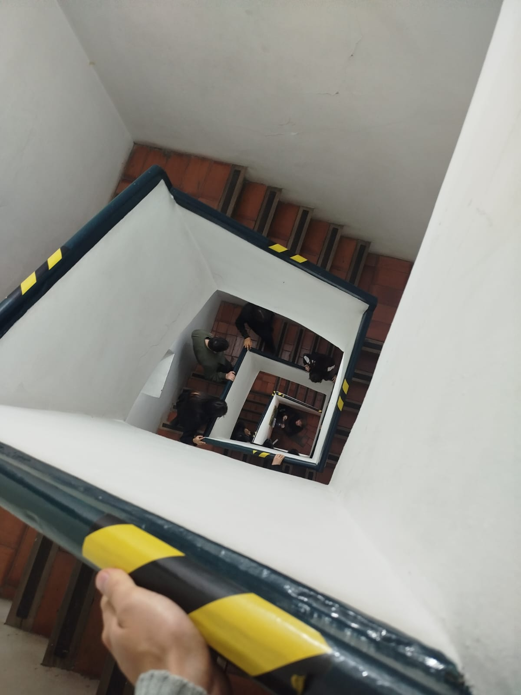

*Example story with an image next to the title and images in the text: replace it with one of yours.*

No ship has passed this coast in twenty years, but Elías still climbs the hundred and twelve steps every evening to turn on the light.

In town they say he's mad. He says someone has to let the sea know the coast is still there.


By day the lighthouse looks like a toy left on the rocks.

Nobody climbs it but him.




One foggy night, for the first time in twenty years, someone answered him from the water with three flashes.
