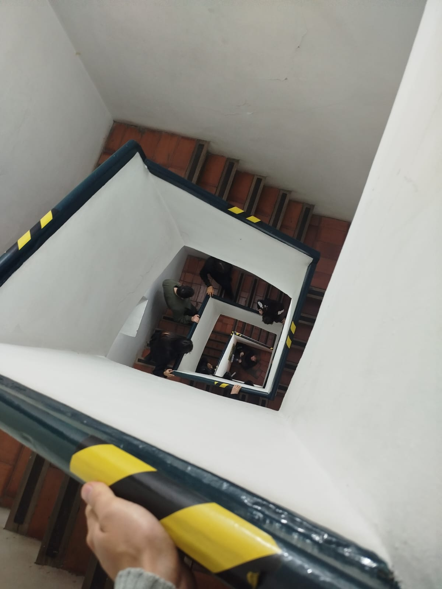

*Cuento de ejemplo con imagen junto al título e imágenes en el texto: reemplázalo por uno tuyo.*

Hace veinte años que no pasa un barco por esta costa, pero Elías sigue subiendo los ciento doce escalones cada tarde para encender la luz.

En el pueblo dicen que está loco. Él dice que alguien tiene que avisarle al mar que la costa sigue ahí.


De día el faro parece un juguete olvidado en las rocas.

Nadie sube, excepto él.




Una noche de niebla, por primera vez en veinte años, alguien le respondió desde el agua con tres destellos.
