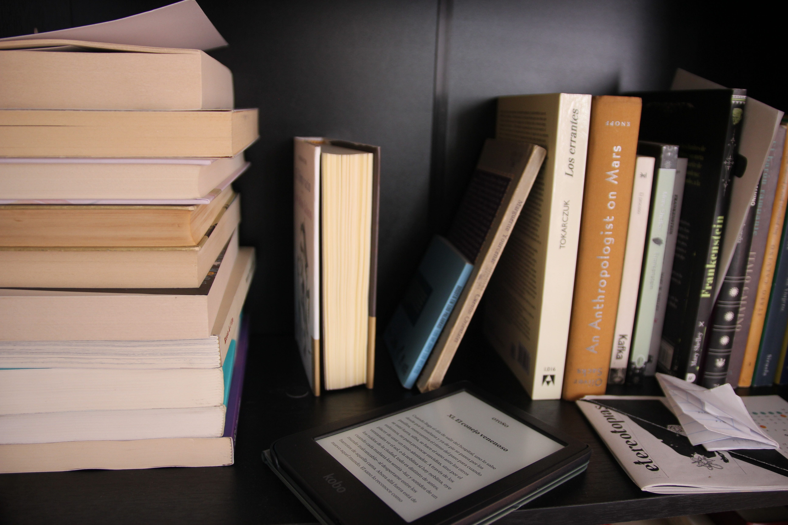

<!-- *Wait, paper, wait for me* -->

About a month ago I got an e-reader (not a Kindle, because I don't like Amazon), and I read two books on it; it was easy, and I felt very focused on reading. It is very easy to find e-books, download them and load them onto the device; and getting them costs three times less than a paper book, whether in time or in money. Another point in its favor: you can change the way you read. If you are one of those people who find it uncomfortable to keep track of page numbers because it makes you feel you are not enjoying the book, you can remove them; or if, on the contrary, you even want to see your reading as a percentage, you can do that too.

> There are plenty of things in favor of these electronic devices, and I have been fortunate to have the privilege of owning one. But I can't quite feel the same as when I have paper in my hands, a sense of being physically present.

Now that I return to my library of paper books (some old, others new, this one unread, that other one half eaten by moths or by the sweat of a few hands, sweat that came before mine), now that I turn my eyes back to those spines I recognize as part of my experiences and of the physical effort of hundreds of people, I can see that my reading has been built from seeing paper and being in contact with it. Even if it doesn't improve my reading comprehension or optimize my time, it does give me a pivot I can trust when it comes to feeling present.

In principle I would like to read more and more, hence my purchase of this little gadget, but I wouldn't want to forget that paper has certain effects on me: that its aged colors, its fragility or the space it takes up in my backpack are things that say books are more than a way of storing words.

I hope to grow fonder of digital reading, and I hope not to forget my experience with the tangible format.
