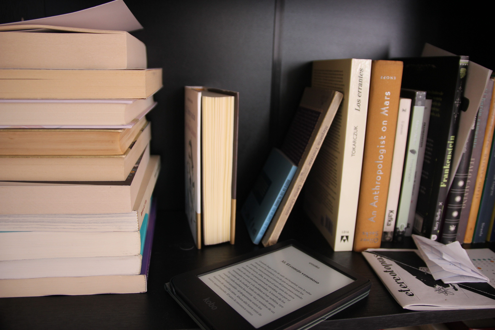

*En cada página una foto*

Hace cerca de un mes conseguí un lector de libros electrónicos (no un Kindle porque no me agrada Amazon) en el que leí dos libros, no me costó hacerlo y me sentí muy enfocado en leer. Es muy fácil conseguir libros electrónicos, descargarlos e instalarlos en el aparato este; además conseguirlos cuesta tres veces menos que un libro en papel, ya sea en tiempo o en dinero. Otro punto a favor: puedes modificar cómo lees, si eres de las personas que les incomoda estar pendiente del número de la página porque te hace pensar que no lo estas disfrutando puedes eliminarlos, o si por el contrario quieres ver incluso tu lectura como un porcentaje, puedes hacerlo.

> Hay un montón de cosas a favor de estos aparatos electrónicos y he sido afortunado por el privilegio de tener uno. Pero no puedo terminar de sentir lo mismo que cuando tengo el papel encima, una sensación de sentirme presente de manera física. 

Ahora que vuelvo a mi biblioteca de libros en papel, algunos viejos, otros nuevos, este sin leer o aquel otro medio comido por las polillas o el sudor de algunas cuantas manos, sudores anteriores a los míos, ahora que vuelvo la mirada a esos lomos que reconozco como parte de mis experiencias y esfuerzo físico de cientos de personas, puedo percibir que mi leer se ha elaborado a partir de ver el papel y estar en contacto con él. Aunque no mejore mi comprensión lectora o no optimice mi tiempo, sí que me proporciona un pivote en el cuál confiar cuando de sentirme presente se trata.

En principio me gustaría leer más y más, por ello mi adquisición del aparatico este, pero no me gustaría olvidar que el papel tiene ciertos efectos en mí; que sus colores viejos, su fragilidad o el espacio que ocupa en mi maleta son elementos que dicen que los libros son más que una forma de guardar palabras.

Espero encontrar con más agrado la lectura digital o electrónica y espero no olvidar mi experiencia con el formato tangible.